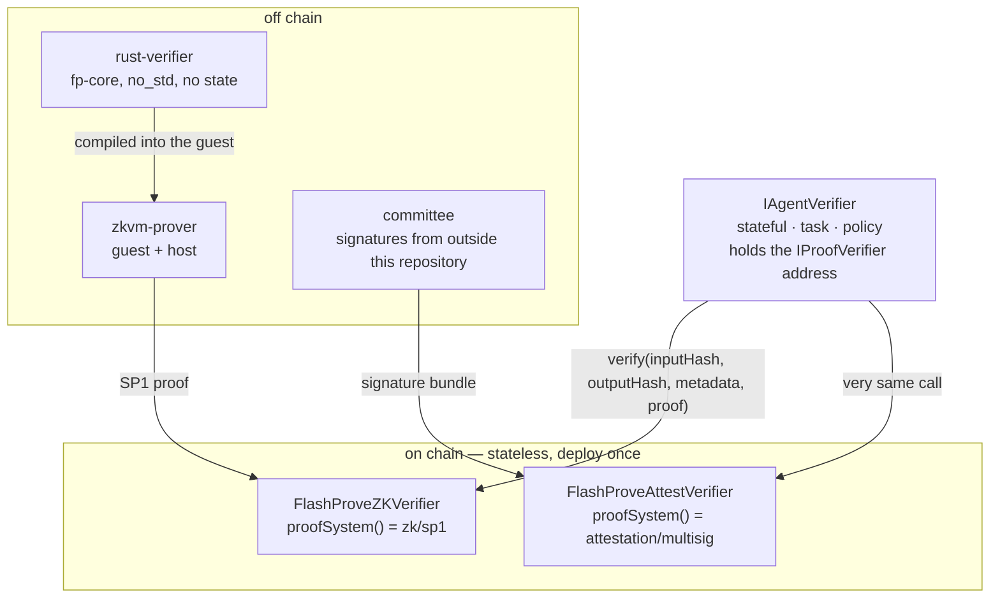

# flashprove-onchain-verifier

**Two stateless [ERC-8274] `IProofVerifier` implementations for FlashProve inference proofs — one
backed by a zk proof, one backed by a committee attestation. Deploy either once; every agent
verifier on the chain can call it.**

FlashProve checks a model's inference without re-running the model: a proof is verified against a
commitment, and the answer is recomputed from public data. This repository is the on-chain half of
that — the contracts that accept that evidence, and the toolchain that produces it.



Once, from the top: your `IAgentVerifier` holds the address of one of the two on-chain verifiers
and asks it one question — is this input/output pair supported by this evidence? Below it the answer
comes from two different places: `zkvm-prover`, which compiles `rust-verifier`'s `no_std` core into
an SP1 guest, or a committee signing outside the chain. Only the two verifiers are deployed, each
once, and neither of them holds state; every application brings its own `IAgentVerifier` on top.

## The contracts

Both are stateless implementations of [ERC-8274]'s inner layer, `IProofVerifier`. Applications wrap
one in their own stateful `IAgentVerifier` — which holds the task, the policy and the authority —
and settlement contracts call that, never this.

| Path | Contract | `proofSystem()` | Evidence |
|---|---|---|---|
| `zk/` | `FlashProveZKVerifier` | `"zk/sp1"` | an SP1 proof over FPV1 public values |
| `attestation/` | `FlashProveAttestVerifier` | `"attestation/multisig"` | signatures from a pre-approved committee |

Both answer the same call:

```solidity
verify(bytes32 inputHash, bytes32 outputHash, bytes calldata metadata, bytes calldata proof)
    external view returns (bool);
```

The zk path answers true only when SP1 accepts the proof for `programVKey` and the public values'
two digests equal the caller's hashes. The attestation path answers true once enough distinct
committee members signed the same input/output pair — a guarantee that rests on the committee, not
on a proof system. Its preimage and bundle encoding are still TODO for the committee owner.

Neither reverts on bad evidence: both return `false`.

## Using it

`metadata` is 32 bytes on both paths — the SP1 program vkey on the zk path, a configuration hash on
the attestation path. `proof` is the public values plus the proof on the zk path, and the signature
bundle on the attestation path.

`inputHash` and `outputHash` are defined by the backend, and [ERC-8274] requires that definition to be
documented:

```
INPUT_DOMAIN     = "FlashProve/input-v1\0"
input_digest     = SHA-256(INPUT_DOMAIN ‖ length-prefixed ten inputs, in guest read order)
result_v1_digest = SHA-256(result-v1 line, newline excluded); zero when absent
```

Implemented in `zkvm-prover/fp-pv/src/inputs.rs`; `contracts/README.md` has the FPV1 block and both
hash schemes.

`contracts/src/examples/ExampleAgentVerifier.sol` is a complete outer layer to copy from: it binds a
verifier, a program vkey, a commitment ID and an accepted-verdict mask, authorizes agents, and
consumes the task on success. Everything else — which verdicts count, who may submit — is policy,
and policy is yours.

```sh
cd contracts && forge test          # 46 tests, including the negative controls
contracts/scripts/anvil-smoke.sh    # the whole call path on a local anvil
cd zkvm-prover && cargo test --workspace
rust-verifier/scripts/parity.sh     # CLI parity gates against the C++ reference
```

A flipped proof byte or a wrong commitment ID must come back `NO`, exit 1. The `no_std` gate:

```sh
grep -rn "use std\|extern crate std\|static mut" rust-verifier/fp-core/src/ \
  && echo VIOLATION || echo NO_STD_OK
```

The verification key is frozen in `config/vkey.json` and tied to the guest ELF: rebuild the guest
and it no longer matches. `docs/handoff.md` records the values and how to re-derive them.

## Contribution

This repository is one project under [trustless-ai](https://github.com/trustless-ai) — an open home
for the standards, reference implementations and live proofs that make AI claims checkable by
recomputation rather than by trust. How the organisation works, and what else lives in it, is in the
[org README](https://github.com/trustless-ai).

- **Open a PR.** A bug, a doc fix, a test, a better hash scheme — every contribution counts, and we
  review as fast as we can. One rule, the same as the org's: nothing goes in that a third party
  cannot independently verify from public data.
- **Talk it through on [Telegram](https://t.me/+P7blHRwexzAyYWZh).** Brainstorm, share ideas, meet
  the people building this. No commitment needed.

The most useful contribution right now is an independent run: deploy the verifier on a chain you
care about, call `verify()`, and send us the gas figure we are still missing.

## License

Apache License 2.0 — the same license as the FlashProve reference implementation and the SP1 zkVM.
See `LICENSE`, and `NOTICE` / `THIRD_PARTY.md` for the third-party notices.

[ERC-8274]: https://ethereum-magicians.org/t/erc-8274-ai-inference-proof-verification/28083
